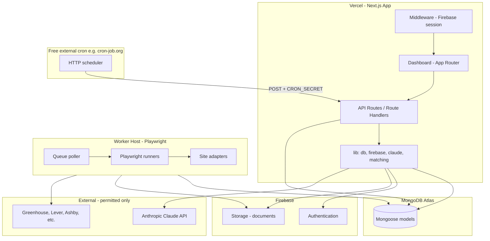
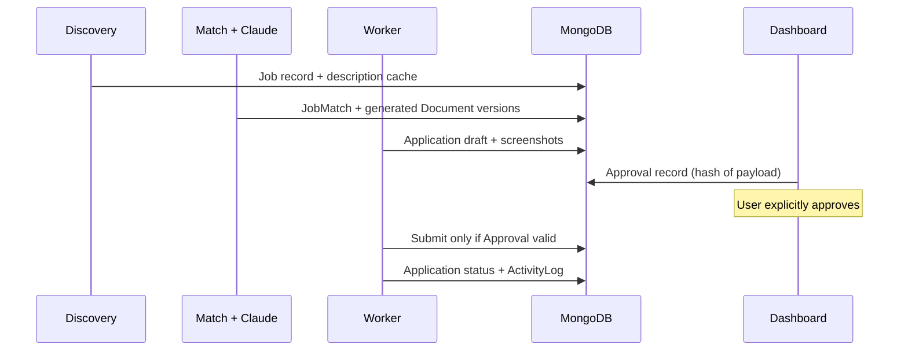

# Architecture — Job Application Automation Platform

## High-Level Topology



## Repository Layout (Target)

```
approvals/
├── app/                    # Next.js App Router (pages + API)
│   ├── (auth)/
│   ├── (dashboard)/
│   └── api/
├── components/             # UI + shadcn
├── lib/
│   ├── db/                 # connect, models
│   ├── firebase/           # admin SDK, client config
│   ├── auth/               # verify session, guards
│   ├── claude/             # client, prompts, schemas (Phase 4+)
│   ├── matching/           # scoring engine (Phase 4+)
│   ├── jobs/               # discovery providers (Phase 3+)
│   └── documents/          # parse/generate (Phase 2+)
├── worker/                 # Separate package: Playwright + cron
│   ├── adapters/
│   ├── jobs/
│   └── index.js
├── public/
├── PROJECT_REQUIREMENTS.md
├── ARCHITECTURE.md
├── DEVELOPMENT_PLAN.md
└── AGENTS.md
```

## Responsibility Boundaries

| Concern | Location | Consumer |
|---------|----------|----------|
| UI & review/approval | `app/(dashboard)` | User |
| Auth gate | `middleware.js` + `lib/auth` | All protected routes |
| Business rules | `lib/*` services | API routes |
| Persistence | `lib/db/models/*` | Services, worker |
| AI | `lib/claude/*` | API + worker (server only) |
| Browser automation | `worker/*` only | Never in Vercel serverless for long sessions |
| File bytes | Firebase Storage | Signed URLs from API |

## Authentication Flow (Firebase)

1. Client: Firebase Auth (email/password or Google — owner-configured).
2. Client sends Firebase ID token to API (`Authorization: Bearer`) or session cookie pattern via dedicated exchange route.
3. Server: Firebase Admin SDK verifies token on each protected API call and in middleware for dashboard routes.
4. MongoDB `UserProfile` keyed by `firebaseUid`; created on first login.

No Claude or worker secrets in client bundles. Firebase client config uses public keys only.

## Data Flow — Approval-Bound Application



Approval document stores cryptographic hash or canonical JSON snapshot of: `jobId`, `documentVersionIds`, `answers`, `formPayload`. Any drift invalidates approval.

## Job Discovery — Provider Pattern

```javascript
// Conceptual interface (Phase 3)
// discover({ filters }) -> AsyncIterable<NormalizedJob>
// normalize(raw) -> { externalId, source, url, title, description, ... }
```

Registry maps `source` → provider implementation. Dedupe by `(source, externalId)` and URL canonicalization. Expiry job marks `Job.status = 'expired'`.

## Matching Engine (Phase 4)

Deterministic scoring in `lib/matching` using profile + parsed job fields; optional Claude enrichment for narrative “why suitable” stored separately from numeric score. Weights configurable in `AutomationSettings`.

## Claude Service (Phase 4+)

- Single `ClaudeClient` with env `ANTHROPIC_API_KEY`, `CLAUDE_MODEL_DEFAULT`, `CLAUDE_MODEL_LIGHT`.
- Zod or JSON Schema validation on responses.
- `PromptRegistry` with version strings logged on each call.
- Usage persisted on `ActivityLog` or dedicated `AiUsage` subdocument.

## Scheduled Processing (External Cron — Free)

Scheduled discovery and maintenance run on **Vercel via Next.js API routes**, triggered by a **free external cron** service (preferred: [cron-job.org](https://cron-job.org)). No paid schedulers (Vercel Cron paid tiers, Upstash QStash, etc.) unless owner approves.

| Endpoint | Purpose | Query |
|----------|---------|--------|
| `POST /api/cron/discovery` | Provider-based job discovery | `?schedule=hourly\|daily` |
| `POST /api/cron/expire-jobs` | Mark stale listings expired | `?schedule=hourly\|daily` |
| `GET /api/cron/executions` | Execution history (dashboard auth) | optional `?task=` |

**Authentication:** `Authorization: Bearer <CRON_SECRET>` or header `x-cron-secret` (same value as env `CRON_SECRET`). Middleware allows `/api/cron/*` when the secret matches.

**Overlap / duplicates:**

- MongoDB `CronExecution` records every run (`running`, `completed`, `failed`, `skipped`).
- Concurrent runs for the same `task` return **409** with `reason: overlap` if a previous run is still `running` within the lock window (~20 minutes).
- Optional `X-Idempotency-Key` (or `?idempotencyKey=`) prevents replay of the same external trigger.

**Schedule config (Settings UI):** per-user `discoverySchedule` and `expireJobsSchedule` (`off` | `hourly` | `daily`). The external cron job frequency must match the selected value (e.g. cron-job.org “every hour” → `?schedule=hourly`).

**Logging:** Results and failures persist in `CronExecution` and summary lines in `ActivityLog` (`type: cron`). The Playwright worker does **not** execute scheduled discovery or expiry checks.

### cron-job.org example

1. Create job: `POST https://<your-vercel-app>/api/cron/discovery?schedule=daily`
2. Schedule: once per day (or hourly with `schedule=hourly`)
3. Request method POST; header `Authorization: Bearer <CRON_SECRET>`
4. Duplicate a second job for `.../api/cron/expire-jobs?schedule=daily`

## Worker Deployment

- Polls MongoDB for **browser jobs only**: `prepare_application`, `submit_application`.
- `submit_application` checks `Approval.status === 'approved'` and `approvalPayloadHash` matches current draft.
- Exits or pauses with `needs_human` on CAPTCHA/MFA.
- Free hosting candidates: Railway hobby, Render free, Fly.io free tier, or local process.
- **No embedded `node-cron`** — scheduling is external.

## Vercel Constraints

- API routes for CRUD, Claude calls under timeout limits (stream or chunk for long generations in later phases).
- No Playwright on Vercel functions; worker is mandatory for automation.
- MongoDB connection pooling via single cached Mongoose connection in serverless.

## Environment Variables (Overview)

**Next.js (Vercel)**

- `MONGODB_URI`
- `FIREBASE_PROJECT_ID`, `FIREBASE_CLIENT_EMAIL`, `FIREBASE_PRIVATE_KEY`
- `NEXT_PUBLIC_FIREBASE_*` (client SDK)
- `FIREBASE_STORAGE_BUCKET`
- `ANTHROPIC_API_KEY`, `CLAUDE_MODEL_*`
- `WORKER_API_SECRET` (worker ↔ API queue routes)
- `CRON_SECRET` (external cron triggers)

**Worker**

- Same DB + storage + `WORKER_API_SECRET`; `PLAYWRIGHT_*` as needed.

## Dashboard Pages (Route Map)

| Path | Purpose |
|------|---------|
| `/` | Overview stats |
| `/jobs/discover` | Search & filters |
| `/jobs/recommended` | Scored list |
| `/jobs/[id]` | Job detail |
| `/approvals` | Pending approvals |
| `/applications` | Submitted pipeline |
| `/applications/[id]` | Detail + timeline |
| `/documents` | CV management |
| `/profile` | Professional profile |
| `/activity` | Agent / automation log |
| `/sessions` | Browser sessions |
| `/settings` | Automation & matching weights |

## Security Notes

- Personal app: optional allowlist of Firebase UIDs in env.
- Rate limit API routes (e.g. `@upstash/ratelimit` only if owner approves; else in-memory sliding window per deployment instance for Phase 1).
- Sanitize all job HTML descriptions before storage/display.
- Worker runs with least-privilege storage paths per `firebaseUid`.

## Scalability Without Overengineering

- Start single-tenant (owner only).
- Provider and adapter registries allow new sources without changing core models.
- Worker queue is MongoDB-backed job collection before considering Redis/queues.
